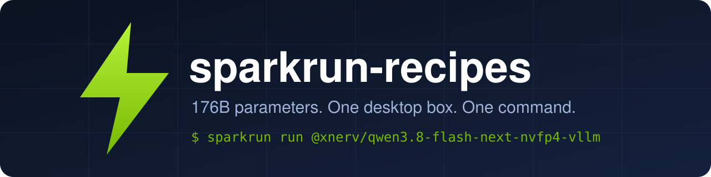

 <p align="center">
  
</p>

<h1 align="center">⚡ sparkrun-recipes</h1>

<p align="center">
  <b>A 176-billion-parameter model. One desktop box. One command.</b><br />
  Ready-to-run <a href="https://sparkrun.dev">sparkrun</a> recipes for <b>Qwen3.8-Flash-Next</b> on a single <b>NVIDIA DGX Spark (GB10)</b>.
</p>

<p align="center">
  <a href="https://sparkrun.dev"></a>
  
  
  
  <a href="https://github.com/XNerv/sparkrun-recipes/actions/workflows/validate.yml"></a>
</p>

---

## The pitch

Qwen3.8-Flash-Next is a **~176B-parameter model** (125B main + 51B n-gram, ~6B active).The NVFP4 checkpoint is reported to occupy approximately **134 GB** on disk, while the DGX Spark provides **128 GB** of unified memory. Loading the entire checkpoint into memory would exceed the system's unified-memory capacity, leaving no room for the operating system, KV cache, or other runtime allocations.

The upstream implementation addresses this by serving the large n-gram embedding table directly from NVMe through `mmap`, rather than loading the entire table into memory. The upstream project reports approximately **80 GB** of resident model weights with this approach. Actual memory usage depends on the model, runtime, workload and system configuration.

This repository packages that setup as **sparkrun recipes**, so you can launch the configured workload without maintaining a long `docker run` command.

```text
your terminal ──▶ sparkrun ──▶ ghcr.io/xnerv/qwen3.8-flash-next-gb10-vllm ──▶ Qwen3.8-Flash-Next
```

> **Validation status:** The recipes pass `sparkrun recipe validate --strict` and render the expected serving command. They have **not yet been verified through a complete model startup and inference run on GB10 hardware**. See [docs/VALIDATION.md](docs/VALIDATION.md) for the validation scope and outstanding checks.

## Quick start

You need a DGX Spark or another compatible GB10 system, Docker with the NVIDIA container runtime, sufficient free NVMe space for the model files, and [sparkrun](https://sparkrun.dev) installed.

```bash
# 1. Add this registry
sparkrun registry add https://github.com/XNerv/sparkrun-recipes.git

# 2. List its recipes
sparkrun list @xnerv

# 3. Inspect the base recipe before launching
sparkrun show @xnerv/qwen3.8-flash-next-nvfp4-vllm

# 4. Launch the model
sparkrun run @xnerv/qwen3.8-flash-next-nvfp4-vllm
```

The first launch downloads the model files and may take some time. Subsequent launches can reuse the local cache.

Once the server reports `Application startup complete`, the OpenAI-compatible API is expected to be available on port `8000`, as configured by the recipe:

```bash
curl http://<spark-host>:8000/v1/chat/completions \
  -H 'Content-Type: application/json' \
  -d '{"model":"qwen3.8-flash-next","messages":[{"role":"user","content":"Say hi from a desktop supercomputer."}]}'
```

Replace `<spark-host>` with the hostname or IP address of your machine.

## The menu

| **Recipe**                                 | **Context**            | **Intended use**                                                                                      | **Profile**                                      |
| :----------------------------------------- | :--------------------- | :---------------------------------------------------------------------------------------------------- | :----------------------------------------------- |
| `qwen3.8-flash-next-nvfp4-vllm`            | 262144 tokens (native) | **Recommended default!** General-purpose chat, RAG and agentic workloads.                             | Balanced configuration for general-purpose use   |
| `qwen3.8-flash-next-nvfp4-ctx512k-vllm`    | 524288 tokens (YaRN)   | Long-document analysis, large codebase review and multi-document synthesis.                           | Extended context with potential speed and quality trade-offs |
| `qwen3.8-flash-next-nvfp4-concurrent-vllm` | 262144 tokens (native) | Multi-client serving, API gateways and concurrent agent workloads.                                   | Tuned for higher concurrency, supporting up to 16 concurrent requests |

> **IMPORTANT — SINGLE-NODE DEPLOYMENT ONLY**
>
> All recipes require a single-node deployment. The `mmap` design requires the embedding table to reside on the serving node's local NVMe storage. Multi-node deployment is not supported in this recipes.

## What the recipes configure

- **Prefix caching:** Uses the upstream image's patched implementation. Validate cache-hit behavior against the exact image before relying on it in production.
- **Deterministic decoding:** Configures greedy decoding for repeatable results under the same runtime and execution conditions.
- **MTP speculative decoding:** Uses the model's draft head for speculative decoding.
- **Tool calling and reasoning parsers:** Configures the `qwen3_coder` and `qwen3` parsers.
- **Pinned artifacts:** References a fixed model revision and an immutable container image digest rather than a floating `latest` tag.
- **Minimal recipe overrides:** Keeps model and runtime settings in the base recipe, with derived recipes changing only their intended parameters.

## Where things live

```text
.sparkrun/
  registry.yaml                 Registry manifest
recipes/
  qwen3.8-flash-next/
    vllm/                       Model recipes
docs/
  IMAGE-CONTRACT.md             Image contract and update procedure
  VALIDATION.md                 Validation scope and outstanding checks
.github/
  workflows/
    validate.yml                Recipe validation on pushes and pull requests
```

The container image is built from [XNerv/qwen3.8-Flash-DGX](https://github.com/XNerv/qwen3.8-Flash-DGX), a fork of [blazux/qwen3.8-Flash-DGX](https://github.com/blazux/qwen3.8-Flash-DGX), and is published as `ghcr.io/xnerv/qwen3.8-flash-next-gb10-vllm` for `linux/arm64`.

See [docs/IMAGE-CONTRACT.md](docs/IMAGE-CONTRACT.md) for the image's responsibilities and the procedure for updating its pinned digest.

## Tweaking a recipe

Override supported defaults at launch without editing the recipe:

```bash
# Override the API port and maximum concurrent sequences
sparkrun run @xnerv/qwen3.8-flash-next-nvfp4-vllm \
  -o port=9000 \
  -o max_num_seqs=4

# Preview the generated serving command without launching the workload
sparkrun run @xnerv/qwen3.8-flash-next-nvfp4-vllm --dry-run
```

For a permanent variation, create a derived recipe, use `include:` to inherit the base configuration, and change only the settings you need.

## Benchmarking

The YAML files in [`benchmarks/`](benchmarks/) are llama-benchy profiles. Start with `quick.yaml` to check that the recipe launches and answers a request; it runs one test point and is not suitable for performance conclusions. For analysis, use the profile that isolates the question you want to answer:

| Profile | When to use it | Recipe and expected insight |
| :--- | :--- | :--- |
| `concurrency-8.yaml` | Compare load from 1 to 8 simultaneous requests with prompt, output, and context held fixed. | Use with the base or concurrent recipe. Shows how throughput and latency change as load increases, up to the base recipe's `max_num_seqs: 8`. |
| `concurrency-16.yaml` | Extend the same comparison to 16 simultaneous requests. | Use only with `qwen3.8-flash-next-nvfp4-concurrent-vllm`, which sets `max_num_seqs: 16`; the base recipe is capped at 8. |
| `prefill.yaml` | Compare prompt lengths while holding generation, context depth, and concurrency fixed. | Helps reveal how prompt processing changes with input size. |
| `generation.yaml` | Compare output lengths with a fixed prompt and one request. | Helps compare generation rate and request latency as more tokens are produced; `exact_tg` requests the specified output length. |
| `context-depth.yaml` | Compare prompt processing at progressively deeper positions in a conversation, without the profile's separate cached-context measurement. | Shows the cost of processing at a larger context depth; higher depths can increase memory pressure and latency. |
| `prefix-cache-depth.yaml` | Measure prompt processing after loading a shared context into the prefix cache. | With `depth > 0`, llama-benchy reports a separate cached-context measurement. `prefix_caching: true` enables this benchmark measurement; it does **not** disable or enable prefix caching in the server. |
| `standard.yaml` | Run a broader, balanced sweep across prompt, generation, context, and concurrency. | Useful for general characterization, but more expensive and less diagnostic than changing one dimension at a time. It also enables the cached-context measurement at nonzero depths. |
| `extended-concurrency-8.yaml`, `extended-concurrency-16.yaml` | Run a broad, long sweep for detailed characterization. | Use the 16-request profile only with the concurrent recipe. These profiles combine dimensions, include cached-context measurements, and take substantially longer. |

Example: compare concurrency on the base recipe and save the results:

```bash
sparkrun benchmark perf recipes/qwen3.8-flash-next/vllm/qwen3.8-flash-next-nvfp4-vllm.yaml \
  --profile benchmarks/concurrency-8.yaml \
  --output results/base-concurrency-8.yaml
```

For the 16-request comparison, use the concurrent recipe and `benchmarks/concurrency-16.yaml`. To measure cached-context processing, use `benchmarks/prefix-cache-depth.yaml`; compare its cached-context results with `context-depth.yaml` at the same depths, while keeping in mind that these are different benchmark paths.

For meaningful comparisons, keep the recipe and image revision, benchmark profile, host, and machine state consistent; avoid other workloads on the machine. Profiles with `runs: 3` include repeated measurements and a warm-up, but results can still vary. Compare the same test points and inspect prompt-processing rate, generation rate, time to first token, and total throughput where reported; higher aggregate throughput under concurrency can come with higher per-request latency. The [Sparkrun benchmarking guide](https://sparkrun.dev/tutorials/benchmarking/) describes the measurements and result files. These profiles have not been run on DGX Spark hardware yet, so the expected insights are hypotheses to test, not measured results.

## Known limitations

- **Single-node deployment:** These recipes are configured for one GB10 host.
- **KV cache dtype:** The KV cache is configured as `BF16`. FP8 KV cache is not enabled because the QSA (Qwen Sparse Attention) layers do not support the required path.
- **CPU affinity:** Upstream pins the container to performance cores with `--cpuset-cpus`; sparkrun does not expose an equivalent setting.

## Contributing

Recipes live under `recipes/<family>/<runtime>/` and follow the [sparkrun recipe format](https://sparkrun.dev/recipes/format/).

Before opening a pull request, validate the recipe and inspect the generated command:

```bash
sparkrun recipe validate --strict recipes/<family>/<runtime>/<recipe>.yaml
sparkrun run recipes/<family>/<runtime>/<recipe>.yaml --dry-run
```

Benchmark profiles in `benchmarks/` are reusable llama-benchy presets; adjust their token lengths and concurrency to match the recipe and available hardware. The [official Sparkrun benchmark CLI](https://sparkrun.dev/cli/benchmark/) does not document a separate benchmark-profile validator, so CI checks each profile with the supported benchmark dry run:

```bash
sparkrun benchmark perf recipes/qwen3.8-flash-next/vllm/qwen3.8-flash-next-nvfp4-vllm.yaml \
  --profile benchmarks/quick.yaml --dry-run --solo -H 127.0.0.1
```

CI validates recipes and benchmark profiles on pushes to `main` and on pull requests. These checks do not replace a full startup and inference test on the target hardware.

## Credits

This repository builds on the work of the upstream project and the sparkrun community.

- [blazux/qwen3.8-Flash-DGX](https://github.com/blazux/qwen3.8-Flash-DGX): upstream vLLM implementation and `mmap` approach.
- [@jschmied](https://github.com/jschmied) and the contributors credited upstream: deterministic top-k kernel and related fixes.
- [lancelind/qwen3.8-Flash-DGX](https://github.com/lancelind/qwen3.8-Flash-DGX): sparkrun recipes for the same upstream project, which helped shape this layout.
- [sparkrun](https://github.com/spark-arena/sparkrun) and the [Spark Arena](https://spark-arena.com) team: recipe orchestration and ecosystem.

## License

The recipes are released under the [MIT License](LICENSE). Model weights and the container image have their own licenses; review them before use.
