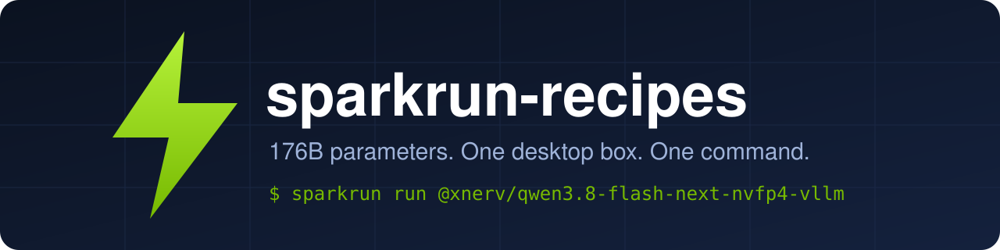

<p align="center">
  
</p>

<h1 align="center">⚡ sparkrun-recipes</h1>

<p align="center">
  <b>A 176-billion-parameter model. One desktop box. One command.</b><br/>
  Ready-to-run <a href="https://sparkrun.dev">sparkrun</a> recipes for <b>Qwen3.8-Flash-Next</b> on a single <b>NVIDIA DGX Spark (GB10)</b>.
</p>

<p align="center">
  <a href="https://sparkrun.dev"></a>
  
  
  
  <a href="https://github.com/XNerv/sparkrun-recipes/actions/workflows/validate.yml"></a>
</p>

---

## The pitch

Qwen3.8-Flash-Next is a **~176B-parameter** model (125B main + 51B n-gram, 6B active). Its NVFP4 checkpoint is
**~125 GiB**, and a DGX Spark has a **128 GB unified memory pool**. On paper that does not fit next to a usable KV cache.

The trick, done by the [upstream recipe](https://github.com/blazux/qwen3.8-Flash-DGX): the giant n-gram embedding
table is a pure lookup, so it is served **straight from NVMe through `mmap`** instead of living in memory. Weights
shrink to **~75 GiB** and the rest of the pool goes to KV cache.

This repository does one boring-but-useful thing: it wraps that setup in **sparkrun recipes**, so you do not have to
remember a 40-flag `docker run`.

```text
   your terminal ──▶ sparkrun ──▶ ghcr.io/xnerv/qwen3.8-flash-next-gb10-vllm ──▶ 🧠 176B on a desk
```

> **Status:** the recipes pass `sparkrun recipe validate --strict` and render the expected serve command, but they have
> **not been booted on a GB10 yet**. What was checked and what is still open is listed in
> [docs/VALIDATION.md](docs/VALIDATION.md).

## Quick start

> You need a DGX Spark (or another GB10 box such as the ASUS GX10) with Docker and the NVIDIA container runtime,
> **~125 GiB of free NVMe** for the weights, and [sparkrun installed](https://sparkrun.dev).

```bash
# 1. Add this registry (one time)
sparkrun registry add https://github.com/XNerv/sparkrun-recipes.git

# 2. See what is on the menu
sparkrun list @xnerv

# 3. Peek before you commit: VRAM estimate, flags, image
sparkrun show @xnerv/qwen3.8-flash-next-nvfp4-vllm

# 4. Serve it
sparkrun run @xnerv/qwen3.8-flash-next-nvfp4-vllm
```

When the log says `Application startup complete`, the OpenAI-compatible API is on port `8000`:

```bash
curl http://<spark-host>:8000/v1/chat/completions \
  -H 'Content-Type: application/json' \
  -d '{"model":"qwen3.8-flash-next","messages":[{"role":"user","content":"Say hi from a desktop supercomputer."}]}'
```

The first launch downloads the checkpoint, so go and make coffee. Later boots only load the weights.

## The menu

| Recipe | Context | Prep needed | Pick it when |
|--------|---------|-------------|--------------|
| `qwen3.8-flash-next-nvfp4-vllm` | 262k (native) | none | **Start here.** Safe defaults, MTP speculative decoding on |
| `qwen3.8-flash-next-nvfp4-500k-vllm` | 500k (YaRN) | none | Long documents and agent loops |
| `qwen3.8-flash-next-nvfp4-concurrent-vllm` | 262k | none | Several clients at once (bf16 recurrent state, 16 sequences) |

The two variants use `include:` to inherit from the base recipe and change only what differs.

All of them are **single-node** (`min_nodes: 1`, `max_nodes: 1`). The mmap design needs the table on the local NVMe of
the machine that serves it, so do not try to spread this model over several Sparks.

## What is inside every recipe

- **Prefix caching that actually works**: a block-size bug that silently zeroed the state on cache hits is patched in the image.
- **Deterministic greedy decoding**: same prompt, same output.
- **MTP speculative decoding** from the model's own draft head.
- **Tool calling and reasoning parsers** wired up (`qwen3_coder`, `qwen3`).
- **A pinned image and checkpoint**: recipes reference an immutable image digest and a fixed checkpoint revision, never a floating `latest`, so a recipe that worked yesterday works tomorrow.
- **No root**: the container runs as the user that launches it (sparkrun's default), and the recipes need no `--trust`.

## Where things live

```text
.sparkrun/registry.yaml     tells sparkrun this repo is a registry
recipes/                    the recipes, grouped by model family and runtime
  qwen3.8-flash-next/vllm/
docs/
  IMAGE-CONTRACT.md         what the image provides and how to bump it
  VALIDATION.md             what was tested, where, and what is still open
.github/workflows/          CI that validates every recipe on each push and PR
```

The image is built from [XNerv/qwen3.8-Flash-DGX](https://github.com/XNerv/qwen3.8-Flash-DGX), a fork of
[blazux/qwen3.8-Flash-DGX](https://github.com/blazux/qwen3.8-Flash-DGX), and published as
`ghcr.io/xnerv/qwen3.8-flash-next-gb10-vllm` for `linux/arm64`.

## Tweaking a recipe

Every default can be overridden at launch without editing the file:

```bash
sparkrun run @xnerv/qwen3.8-flash-next-nvfp4-vllm -o port=9000 -o max_num_seqs=4
sparkrun run @xnerv/qwen3.8-flash-next-nvfp4-vllm --dry-run     # print the serve command, run nothing
```

Want a permanent variation? Copy a recipe, use `include:` to inherit from it, and change only what differs.

## Known limits (read before filing a bug)

- **Single node only**, see above.
- **Clients that send `reasoning_effort: high`** (Claude Code's default) can get a `400` from the stock chat template,
  which accepts only `xhigh`, `medium` and `low`. The upstream `serve.sh` works around it with a patched template; the
  recipes do not do that yet.
- The **KV cache dtype stays `auto` (bf16)**: fp8 KV is refused by the sparse-attention layers.
- **No CPU pinning**: the upstream script pins the container to the performance cores with `--cpuset-cpus`, and
  sparkrun has no equivalent setting.
- Numbers such as boot time and KV pool size come from the upstream project and depend on your box, free RAM and disk.

## Contributing

Recipes live in `recipes/<family>/<runtime>/` and follow the
[sparkrun recipe format](https://sparkrun.dev/recipes/format/). Before opening a pull request:

```bash
sparkrun recipe validate --strict recipes/<family>/<runtime>/<recipe>.yaml
sparkrun run recipes/<family>/<runtime>/<recipe>.yaml --dry-run
```

CI runs the same validation on every recipe.

## Credits

This repo stands on other people's work, and the recipe format is theirs too.

- [blazux/qwen3.8-Flash-DGX](https://github.com/blazux/qwen3.8-Flash-DGX): the patched vLLM recipe and the mmap idea.
- [@jschmied](https://github.com/jschmied) and the contributors credited upstream for the deterministic top-k kernel and other fixes.
- [lancelind/qwen3.8-Flash-DGX](https://github.com/lancelind/qwen3.8-Flash-DGX): sparkrun recipes for the same upstream, which shaped this layout.
- [sparkrun](https://github.com/spark-arena/sparkrun) and the [Spark Arena](https://spark-arena.com) team.

## License

Recipes are released under the [MIT License](LICENSE). The model weights and the container image carry their own
licenses; read them before use.
